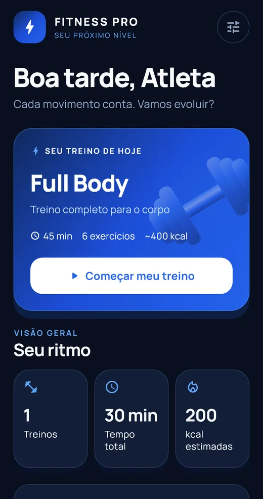
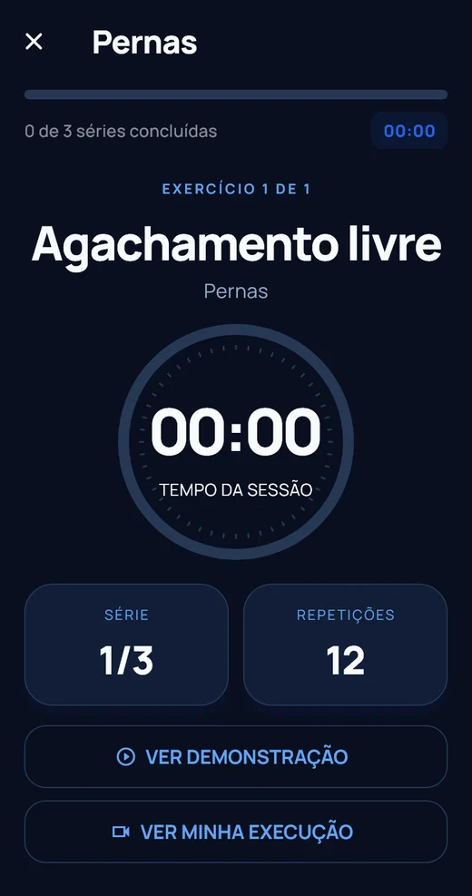

# Fitness Pro — site institucional do Fitness App

Website oficial de apresentação do projeto acadêmico desenvolvido por João Lucas, Raul Dias e Renato Silva. Explica o aplicativo, sua missão proposta, funcionalidades, visão computacional e equipe. Não é uma conversão do Flutter para o navegador.

**TypeScript · React · Next.js / Vinext · Tailwind CSS · Cloudflare Workers**

## Funcionalidades

- Apresentação institucional e navegação por páginas e seções.
- Galeria de capturas reais do aplicativo.
- FAQ com busca e categorias.
- Assistente por API com respostas em streaming e contexto do projeto.
- Formulário de contato com validação e integração de e-mail.
- Demonstração SVG de pontos corporais, com controles de movimento.

## Capturas do aplicativo apresentadas no site

<p>


</p>

Estas são capturas do aplicativo Flutter, não screenshots da interface do website.

## Executar

Requer Git e Node.js >=22.13.0. Os comandos devem ser executados na raiz clonada:

```sh
git clone https://github.com/jluuck4real/fitness-pro-website.git
cd fitness-pro-website
npm ci
npm run dev
```

Abra o endereço Local informado no terminal, normalmente http://127.0.0.1:5173/.

## Estrutura

```text
app/                  Páginas, estilos e endpoints de chat e contato
components/           Interface institucional e componentes reutilizáveis
lib/project-content.ts  Conteúdo, equipe e limites do projeto
public/institutional/ Capturas do app e imagens da equipe
scripts/              Execução, build e verificações
worker/               Entrada do Worker
docs/                 Arquitetura, auditoria e histórico
```

O código usa convenções do App Router do Next.js. Os scripts executam Vinext ou Vite de acordo com o ambiente; o destino de produção é Cloudflare Workers.

## Páginas e seções

- / — Home com apresentação do aplicativo, missão, recursos, tecnologia, equipe e dúvidas.
- /#aplicativo, /#missao, /#funcionalidades, /#tecnologia — Navegação por seções.
- /sobre, /missao, /funcionalidades, /tecnologia — Acesso direto ao conteúdo institucional.
- /equipe — Fotografias, nomes e responsabilidades reais.
- /faq — Perguntas com busca, categorias e accordion acessível por teclado.
- /contato — Formulário com validação, honeypot, limites e estado de configuração.
- /assistente — Chat real por API, separado da lógica do aplicativo, com contexto institucional.

A Home inclui uma demonstração visual de visão computacional: pontos e conexões em SVG, botão para animar o movimento e opção de mudar a posição. A demonstração não solicita câmera nem simula detecção do visitante.

## Configurar chatbot e contato

Copie .env.example para .dev.vars. Preencha somente as variáveis necessárias no arquivo local, ignorado pelo Git, e reinicie o servidor.

- GEMINI_API_KEY: segredo do provedor para respostas reais com streaming.
- GEMINI_MODEL: opcional; padrão gemini-3.6-flash, ajustável à disponibilidade da conta.
- RESEND_API_KEY: segredo do serviço de envio de e-mail.
- CONTACT_FROM: remetente autorizado em um domínio verificado no Resend.
- CONTACT_TO: e-mail real da equipe destinatária.

Na publicação Sites, use as variáveis e segredos de runtime do mesmo Site. Nunca use prefixos NEXT_PUBLIC_ ou VITE_ para credenciais. O Site atual permanece privado, com a autenticação da plataforma. As rotas de envio exigem identidade autenticada quando o serviço está configurado.

Sem as chaves, chatbot e formulário exibem estados pendentes. Nenhuma resposta ou confirmação de envio é inventada. Não há e-mail institucional, links de lojas ou preços presumidos.

O histórico da conversa atual usa sessionStorage. O visitante pode iniciar uma conversa nova; o histórico persistente opcional anterior foi preservado e pode ser apagado. Mensagens são enviadas ao provedor somente ao usar a IA configurada. O formulário usa o servidor e o serviço de e-mail; não guarda os contatos no navegador.

## Verificar

    npx tsc --noEmit
    npm run lint
    npm test
    npm run build

Com o servidor de desenvolvimento aberto:

    npm run test:e2e
    npm run test:legacy

Para testar o Worker de produção local:

    npm run start -- --port 4173

Em outro terminal PowerShell:

    $env:QA_BASE_URL='http://127.0.0.1:4173'
    npm run test:e2e
    npm run audit:mobile

Os scripts usam Chrome no caminho padrão do Windows. Ajuste executablePath/chromePath se necessário. Relatórios HTML/JSON do Lighthouse e capturas ficam em outputs/institutional/. As pontuações são medições locais com simulação mobile e variam com ambiente e rede; 90 é uma meta, não uma garantia.

## Demonstração

O README anterior registra hospedagem privada no Sites. Não há URL pública de demonstração confirmada; o acesso ao site hospedado depende das permissões da plataforma. A execução local não configura automaticamente a identidade necessária às rotas protegidas de envio.

## Fonte dos conteúdos e pendências

Consulte docs/CONTENT_AUDIT.md para as fontes do app, textos editoriais e informações ainda pendentes. docs/IMPLEMENTATION.md explica a arquitetura atual, segurança, animações e validação. docs/LEGACY_PLATFORM.md preserva o relatório da plataforma anterior.

Os recursos anteriores de exercícios, treino, análise corporal e perfil permanecem nos seus arquivos e endereços, sem destaque na navegação institucional. Dados já salvos no navegador foram preservados. O aplicativo Flutter e os arquivos HTML originais não foram alterados.
